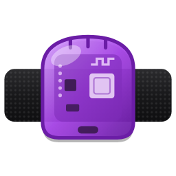
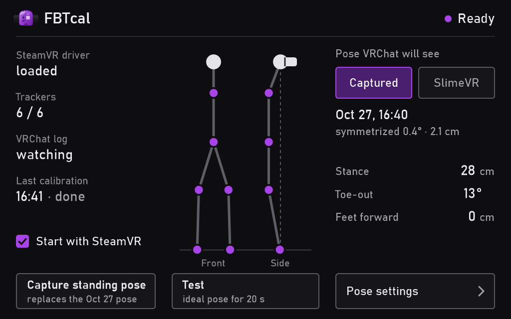

<p align="center"></p>

<h1 align="center">FBTcal</h1>

<p align="center"><b>VRChat full-body calibration without standing up.</b><br>Made for <a href="https://slimevr.dev/">SlimeVR</a>.</p>

<p align="center"><a href="https://github.com/Erik1028/fbtcal/releases/latest"><b>Download fbtcalSetup.exe</b></a> · <a href="https://erik1028.github.io/fbtcal/">Website</a></p>

<p align="center"></p>

VRChat calibrates full-body tracking from the pose you are in when you pull the triggers, so it wants you
to stand up straight. If you play in bed, in a chair, or can't stand, the calibration comes out bent and twisted.

FBTcal takes care of that one moment. While VRChat calibrates, it shows VRChat your trackers in the pose
they would have **if you stood straight under your headset**. You pull the triggers from wherever you are,
and the moment VRChat has taken the calibration, your real movement comes straight back.

## What it does

- **Calibrate lying down or sitting.** Open *Calibrate FBT* in VRChat as usual: FBTcal notices it, the
  trackers jump into a standing pose under your head, you pull both triggers, done.
- **No standing at all, if you like.** The standing pose can come from your **SlimeVR body proportions**
  (the ones the SlimeVR server already knows). Or stand up once, right after a SlimeVR full reset, and let
  FBTcal **capture** your own standing pose.
- **Fine-tune the pose:** distance between the feet, how far the feet turn out, feet forward or back. A
  20-second **Test** shows the pose on your trackers, and you can adjust it while it runs.
- **Lives in the SteamVR dashboard** as its own tab, starts together with SteamVR, sits in the tray otherwise.
  The same view opens in a desktop window from the desktop shortcut or the tray icon.

## Made for SlimeVR

FBTcal is built and tested with **SlimeVR** IMU trackers (`human://` trackers from the SlimeVR server):

- *SlimeVR proportions* reads the body proportions of **SlimeVR server v22 or later**.
- A *captured* pose works with any SlimeVR version.
- Other trackers (Lighthouse, Tundra, …) may work with a captured pose, but nobody has tested that yet.

Not affiliated with SlimeVR or VRChat.

## Setup

1. **Install:** run [`fbtcalSetup.exe`](https://github.com/Erik1028/fbtcal/releases/latest). It installs
   for your Windows user only (`%LOCALAPPDATA%\Programs\fbtcal`), with the .NET runtime built in.
2. **VRChat launch option:** FBTcal knows that VRChat calibrates from VRChat's log, which needs
   `--enable-ik-debug-logging`. In Steam: VRChat › Properties › Launch options, add
   ```
   --enable-ik-debug-logging
   ```
3. **Start SteamVR.** If SteamVR says a new add-on was found, allow the *fbtcal* add-on. Open the dashboard: the
   **FBTcal** tab shows whether the driver is loaded, your trackers are found and the VRChat log is read.
4. **Pick the standing pose:** *SlimeVR* (from your proportions) or *Capture standing pose* (stand straight
   once, right after a SlimeVR full reset; a 10-second countdown and beeps guide you).
5. **Calibrate in VRChat** the usual way, from wherever you are. Rising tone: the standing pose is on.
   Falling tone: back to your real movement.

## Good to know

- Only **VRChat** is detected automatically. In other games, *Test* gives you 20 seconds of the standing
  pose to calibrate in.
- VRChat keeps the calibration across avatar switches, but not across restarts: calibrate once per session.
- FBTcal fixes the **pose** VRChat calibrates from, not your trackers' rotations. If a leg is twisted even
  when you stand, do a SlimeVR mounting reset first.
- Your pose and settings live in `%APPDATA%\fbtcal`, the log in `%APPDATA%\fbtcal\fbtcal.log`.
- **Uninstall:** Windows Settings › Apps › FBTcal. It removes the SteamVR driver and the start with SteamVR,
  and keeps your settings.

## How it works

A tiny **SteamVR driver** (no extra devices) hooks the pose updates that tracker drivers send to SteamVR,
the same way [OpenVR-SpaceCalibrator](https://github.com/pushrax/OpenVR-SpaceCalibrator) does. Normally it
passes everything through unchanged. While VRChat calibrates, the **FBTcal app** writes an ideal pose for
each tracker into shared memory: your standing pose, turned to your headset's heading and hung under its
position. The driver uses that only while the app keeps a 250 ms heartbeat alive, so if the app stops,
everything is real again at once.

The standing pose comes either from a capture (each tracker relative to the headset, made left/right
symmetric) or from the SlimeVR server's skeleton: bone lengths from your SlimeVR profile, the head centre
10 cm behind the headset, each tracker at the end of its bone, like the SlimeVR driver places them.

## Building from source

- `driver\build.bat` builds the driver (Visual Studio 2022 Build Tools, C++).
- `build_setup.ps1` builds `release\fbtcalSetup.exe` (the .NET 8 SDK, self-contained single file).
- Tests without SteamVR:
  - `driver\build\hooktest.exe driver\fbtcal\bin\win64\driver_fbtcal.dll` - the driver on a fake SteamVR host;
  - `cd app && python -m unittest discover -s tests` - the pose maths (Python + numpy, the reference);
  - `python app\tests\make_vectors.py v.json` then
    `dotnet run --project tray\tests -c Release -- v.json driver\build\hooktest.exe driver\fbtcal\bin\win64\driver_fbtcal.dll` -
    the C# app against the Python reference.
- `fbtcal.exe --render-panel <folder>` draws every state of the dashboard tab to PNG files.

## License

MIT, see [LICENSE](LICENSE). Third-party parts: [THIRD-PARTY-NOTICES.md](THIRD-PARTY-NOTICES.md).
